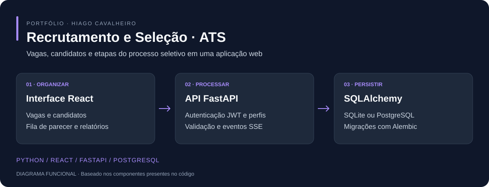

# Sistema de Recrutamento e Seleção (ATS)

**Aplicação web para organizar vagas, candidatos e etapas do processo seletivo.**



*Diagrama do funcionamento baseado no código; não é uma captura de tela.*

[Início rápido](#início-rápido) · [Funcionalidades](#funcionalidades) · [Tecnologias](#tecnologias) · [Guia detalhado](docs/GUIA_DE_USO.md)

## Funcionalidades

- Cadastro e acompanhamento de vagas e candidatos.
- Fila de parecer da gestão e indicadores do processo.
- Autenticação JWT e permissões por perfil.
- Listas configuráveis, histórico e auditoria.
- Exportação para Excel e importação de planilha.
- Atualizações em tempo real com Server-Sent Events (SSE).
- SQLite no ambiente local e suporte a PostgreSQL, com migrações Alembic.

## Tecnologias

| Camada | Tecnologias |
| --- | --- |
| API | Python, FastAPI, Pydantic |
| Interface | React, JavaScript/JSX, HTML, CSS, Tailwind CSS |
| Dados | SQLAlchemy, SQLite, PostgreSQL, Psycopg |
| Evolução do banco | Alembic |
| Gráficos e planilhas | Chart.js, OpenPyXL |
| Entrega | Docker, Docker Compose, scripts Shell e Batch |

## Início rápido

Requer Git e Python 3.11 ou superior. No Windows:

```powershell
git clone https://github.com/hiagoac7/rh-ats.git
cd rh-ats
python -m venv .venv
.\.venv\Scripts\python.exe -m pip install -r requirements.txt
Copy-Item .env.example .env
```

Defina uma `SECRET_KEY` própria no arquivo `.env`. Para uso local com SQLite, mantenha `DATABASE_URL` comentada como no exemplo.

```powershell
.\.venv\Scripts\python.exe -m scripts.baixar_bibliotecas
.\.venv\Scripts\python.exe -m scripts.criar_admin "Administrador de exemplo" admin@example.com SUA_SENHA_FORTE RH
.\.venv\Scripts\python.exe -m uvicorn app.main:app --reload --host 127.0.0.1
```

Substitua `SUA_SENHA_FORTE` por uma senha própria. O comando de criação pode atualizar um usuário já existente com o mesmo e-mail; utilize um banco de testes ao experimentar.

Abra a interface em **http://127.0.0.1:8000** e a documentação da API em **http://127.0.0.1:8000/docs**. No Linux/macOS, use `.venv/bin/python` no lugar do executável Windows.

## Como usar

1. Faça login com o usuário criado.
2. Revise as listas e configurações utilizadas pelo processo.
3. Cadastre as vagas e os candidatos.
4. Acompanhe as etapas e os pareceres conforme o perfil de acesso.
5. Consulte os indicadores e exporte os dados quando necessário.

A importação da planilha é opcional para quem precisa trazer dados anteriores. O [guia detalhado](docs/GUIA_DE_USO.md) preserva instruções de importação, endpoints, autenticação, PostgreSQL, migrações e backup.

## Estrutura

```text
app/                 API, modelos, regras e rotas
app/static/          Interface e bibliotecas locais
migrations/          Migrações do banco
scripts/             Importação, manutenção e verificações
docker-compose.yml   Configuração de serviços
docs/                Guia de uso e visão funcional
```

## Configuração e dados

Não publique `.env`, senhas, bancos de produção ou dados de candidatos. Configure a chave de assinatura dos tokens, o banco e os backups antes da implantação. As bibliotecas de interface podem ser servidas localmente por `app/static/vendor/`.

Os comandos foram revisados a partir dos arquivos do projeto; a implantação completa e os fluxos de negócio não foram executados nesta atualização de apresentação.

## Outros projetos

[Inventário Windows](https://github.com/hiagoac7/inventario-ti) · [Coletor Android](https://github.com/hiagoac7/coletor-dispositivos-android) · [Central de Suporte de TI](https://github.com/hiagoac7/Portal-Suporte)
